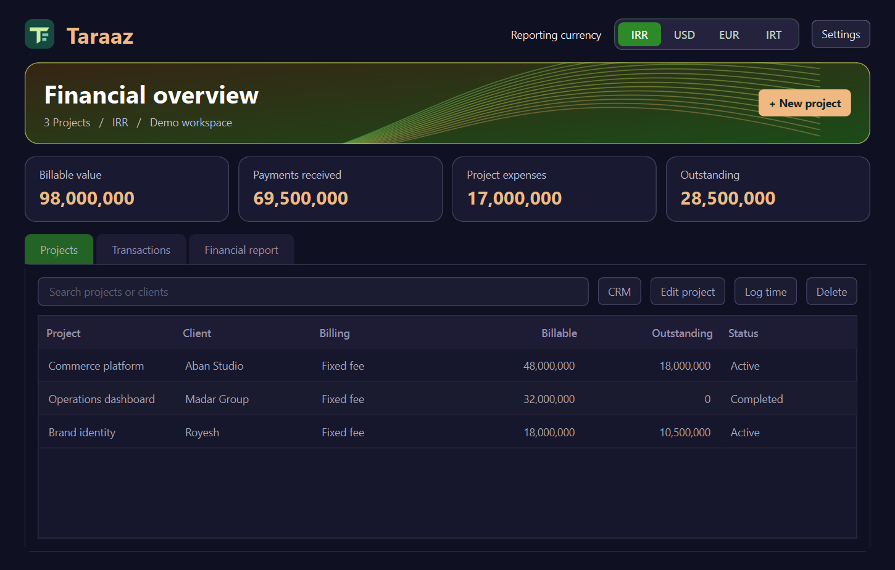

# Taraaz

Track a freelance project from the first billable hour to the final payment, in English or Persian.




## From contract to statement

- **Quote and track work.** Set a fixed fee or hourly rate. Log time, payments and expenses in IRR, IRT, USD or EUR.
- **Follow up.** Keep dated CRM notes per project and get reminders for waiting projects while Taraaz is open.
- **Settle up.** Review each client's balance by currency, export a PDF statement or send it through your Telegram bot.

## Try the demo

```bash
python -m pip install -r requirements.txt
python app.py --demo
```

For your own projects, run `python app.py`. Records stay in a local SQLite database. Settings offers English and Persian, plus light, dark and neon themes.
